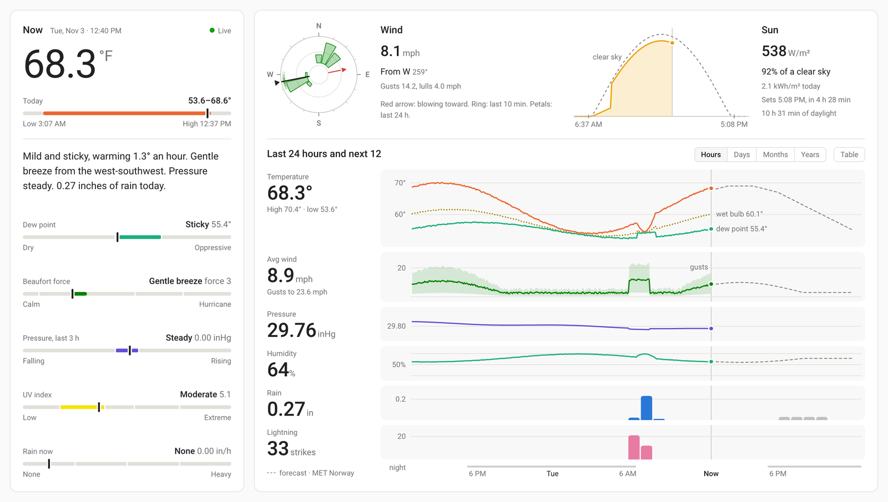
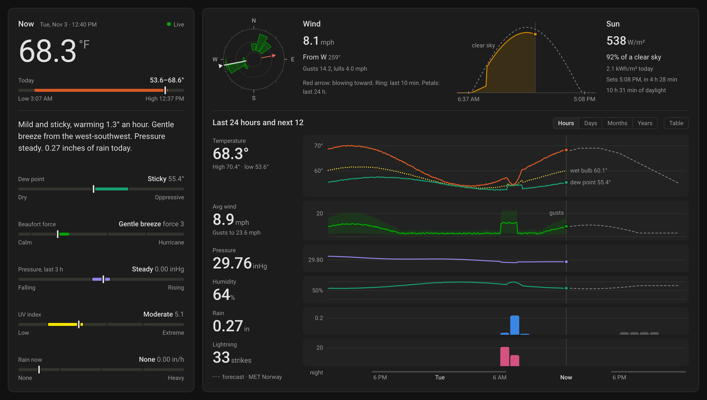
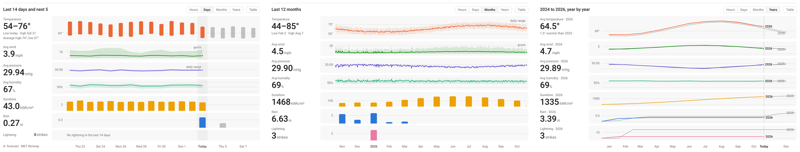
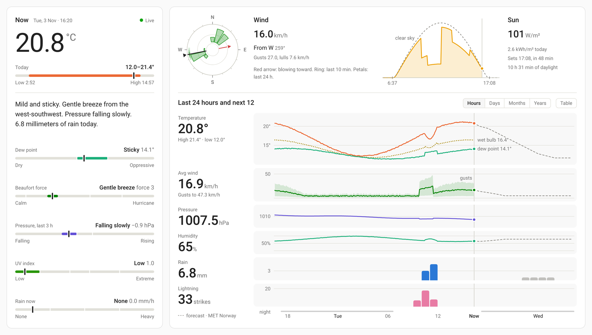

# Tempest Station Card

A Home Assistant dashboard card for WeatherFlow Tempest weather stations. It shows the reading now, what it means in plain words, the wind and the sun, and a meteogram of every measure on one time axis: the last 24 hours, the last 14 days, the last 12 months, or year by year. On a laptop it fits one screen without scrolling.





## What it shows

- **Now.** The temperature, a sentence that says what it means ("Mild and sticky, warming 1.3° an hour. Gentle breeze from the west-southwest…"), and six scales that place each reading on a recognised standard: today's range, dew point comfort, Beaufort force, the three-hour pressure tendency, UV index and rain intensity.
- **Wind.** A dial with a needle that glides between the station's 3-second samples. The black or white wedge marks where the wind comes from, and the red arrow shows where it is going. A soft ring shows the last 10 minutes of direction, and petals show the last 24 hours.
- **Sun.** Measured sunlight under the clear-sky curve for your location, so cloud reads as a bite out of the bell. It also shows today's energy, sunrise or sunset, and day length.
- **Meteogram.** Temperature (with dew point and wet bulb), wind and gusts, pressure, humidity, sunshine, rain and lightning, stacked on one time axis and read through one crosshair. Hover or use the arrow keys to read any moment. Every range also has a table view.



## Requirements

- Home Assistant 2023.9 or newer. It was developed and tested on 2026.10.
- A Tempest station set up with Home Assistant's **WeatherFlow** integration, the local one that listens to the station over UDP. The card finds the station from entities named like `sensor.st_00012345_temperature`.
- The recorder, with its long-term statistics, which are on by default. Months and Years fill in as history accumulates.
- Optionally, a weather entity with a forecast, such as `weather.forecast_home` from the Met.no integration that Home Assistant sets up during onboarding. It draws the dashed forecast lines and bars.

## Installation

### HACS

1. In HACS, open the menu (⋮) and choose **Custom repositories**.
2. Add `https://github.com/Treehouse-00/tempest-station-card` with the type **Dashboard**.
3. Find **Tempest Station Card** in HACS, download it, and reload your browser.

### Manual

1. Download `tempest-station-card.js` from the [latest release](https://github.com/Treehouse-00/tempest-station-card/releases/latest) into your `config/www/` folder.
2. In **Settings → Dashboards → ⋮ → Resources**, add `/local/tempest-station-card.js` as a **JavaScript module**.
3. Reload your browser.

## Configuration

The card is designed for a full-width **panel** view, where it fits the screen:

```yaml
views:
  - title: Weather
    type: panel
    cards:
      - type: custom:tempest-station-card
```

With one Tempest station and Met.no's default forecast entity, that's all it needs. The options:

| Option | Default | What it does |
|---|---|---|
| `station` | found automatically | The station's entity slug: `st_00012345` from `sensor.st_00012345_temperature`. Set it if you have more than one station. |
| `forecast` | `weather.forecast_home` | A weather entity to draw the forecast from. |
| `name` | `Now` | A place name to head the left column, such as `Backyard`. |
| `elevation` | Home Assistant's | The station's elevation in metres, for sea-level pressure. |
| `range` | `hours` | The range to open on: `hours`, `days`, `months` or `years`. Each viewer's last choice is remembered in their browser. |
| `entities` | — | Per-measure overrides for renamed entities, for example `entities: { temperature: sensor.my_tempest_temperature }`. |

## Units and language

The card uses whatever units your entities report: °C or °F, km/h, m/s or mph, hPa, mbar or inHg, and mm or in. Numbers, dates and times follow your Home Assistant language and its 12- or 24-hour setting. The interface text is English.



## Notes

- **Scales.** Beaufort force follows the WMO, pressure tendency the Met Office, rain intensity the AMS Glossary, dew point comfort the US National Weather Service, and UV index the WHO. The clear-sky curve uses the Haurwitz model.
- **Honest charts.** Wind, rain and lightning start at zero, and humidity spans 0–100%. Pressure always spans at least 10 hPa, like a barograph, so a steady day looks steady.
- **Privacy.** Everything runs in your browser against your own Home Assistant. The card makes no outside requests.
- **Forecast credit.** When the forecast comes from Met.no, the card credits MET Norway beside the chart, as their data licence asks.
- **Motion.** The needle and the recent-wind ring animate, unless the viewer's system asks for reduced motion.

Not affiliated with WeatherFlow-Tempest, Inc. Tempest is their trademark.

## License

[MIT](LICENSE)
